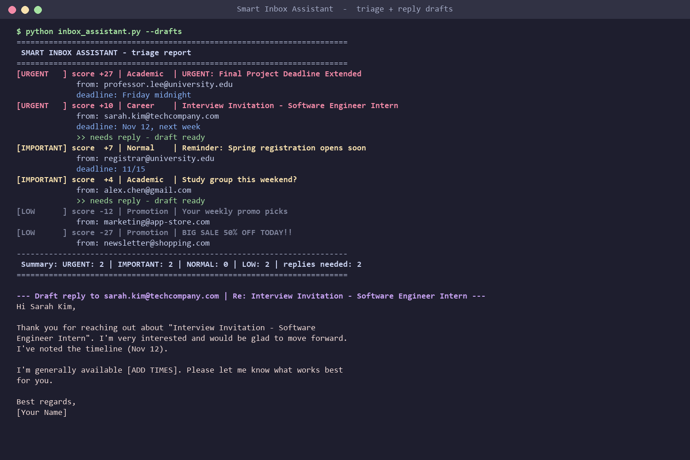

# Smart Inbox Assistant

A lightweight, dependency-free Python tool that triages an inbox: it **scores every email by priority**, **assigns a category**, and **pulls out deadlines**, then **detects which emails are waiting on a reply and drafts one for you to review**, so urgent academic and career messages rise to the top and promotions sink to the bottom.



## Features
- **Weighted scoring** – keywords carry positive or negative weights (`interview` +5, `% off` −4…); a keyword in the subject line counts double.
- **Sender signals** – `.edu` senders get a boost; `newsletter` / `marketing` senders get a penalty.
- **Anti-clickbait rule** – ALL-CAPS or `!!` subjects get a penalty, so "BIG SALE!!" isn't mistaken for urgency.
- **Categories** – Career, Academic, Promotion, Normal.
- **Deadline extraction** – regex finds phrases like `by Friday midnight`, `by Nov 12`, `on 11/15`, `next week`.
- **Reply detection** – flags emails from real people that ask a question or request a response (`please reply`, `your availability`, `?`), and ignores promotions and `noreply` senders.
- **Draft replies** – fills a category-specific template (Career / Academic / Normal) with the sender's name, the subject and any deadline, leaving `[ADD TIMES]`-style placeholders for you to edit before sending. Nothing is ever sent automatically.
- **Priority levels** – URGENT / IMPORTANT / NORMAL / LOW, with color-coded terminal output.
- **JSON in, JSON out** – run it on your own emails and export the results.
- **Unit tested** with Python's built-in `unittest`.

## Quick start
```bash
python inbox_assistant.py                      # run on bundled sample emails
python inbox_assistant.py -i my_emails.json    # your own emails
python inbox_assistant.py -d                   # also print draft replies
python inbox_assistant.py -o report.json       # also export a JSON report
python -m unittest discover -s tests -v        # run the tests
```
Requires Python 3.8+ and nothing else.

Input format (`sample_emails.json`):
```json
[{"sender": "prof@university.edu", "subject": "Project deadline", "body": "Submit by Friday."}]
```

## How it works
1. `score_email()` sums keyword weights and sender-domain weights for each email.
2. `priority_label()` maps the score to a level (≥8 URGENT, ≥3 IMPORTANT, <0 LOW).
3. `categorize()` picks the category whose keywords match most often.
4. `extract_deadlines()` runs regex patterns for weekdays, month-day dates, numeric dates and relative terms.
5. `needs_reply()` + `draft_reply()` flag emails awaiting an answer and build a draft.
6. Results are sorted by score and printed as a report.

## Roadmap
- [ ] Connect to a real inbox through the Gmail API (read-only)
- [ ] Swap the templates for an LLM API so drafts reference the actual email content
- [ ] Learn keyword weights from emails the user marks as important
